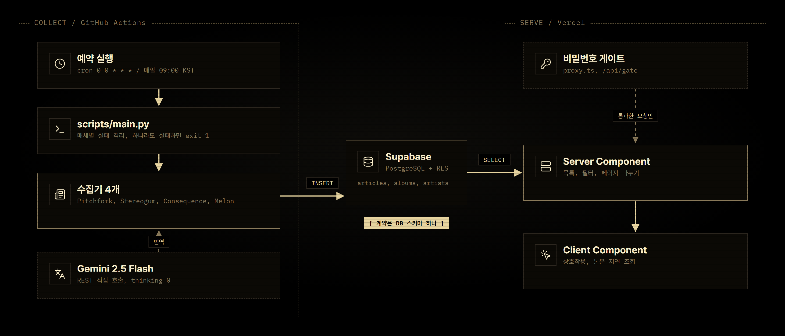
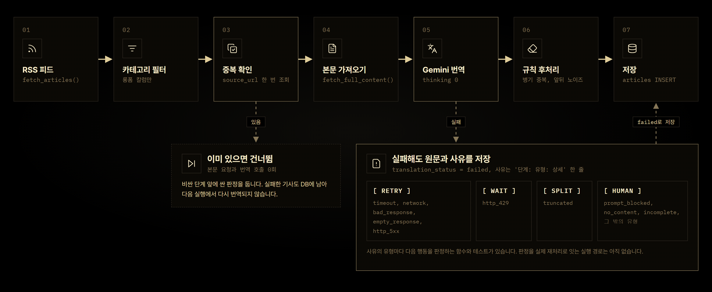

<div align="center">

**해외 음악 웹진의 칼럼을 매일 자동으로 모아 한국어로 번역해 쌓아 둡니다.**

<a href="https://www.dig-em.com/"></a>


</div>

| 영역 | 내용 |
| :--- | :--- |
| 수집 | GitHub Actions가 매일 09:00(KST)에 Pitchfork, Stereogum, Consequence 칼럼과 Melon 앨범 정보를 가져옵니다 |
| 번역 | Gemini 2.5 Flash로 번역하고, 모델이 못 지키는 규칙은 코드로 후처리합니다 |
| 화면 | Next.js가 Supabase를 읽기 전용 키로 조회해 보여 줍니다 |

---

## 🎯 왜 만들었나

음악 평론에서 읽을 만한 글은 대부분 영어입니다. Pitchfork, Stereogum, Consequence 같은 매체가 매일 롱폼 칼럼을 내놓는데, 번역기에 통째로 넣으면 장르명과 연주 기법이 엉뚱하게 바뀌어 문장이 무너집니다.

digem은 **수집과 번역을 파이프라인으로 고정해서** 이 문제를 풉니다. 매일 정해진 시각에 새 칼럼만 골라 가져오고, 음악 평론 문맥을 반영한 규칙으로 번역해 쌓습니다. 사람이 개입하는 단계는 없습니다.

## 🧭 시스템 구성



수집하는 쪽과 보여 주는 쪽은 **서로의 존재를 모릅니다.** 스크래퍼는 프론트엔드가 있는지 모르고, 프론트엔드는 데이터가 어떻게 만들어졌는지 모릅니다. 둘 사이의 계약은 **DB 스키마 하나**뿐입니다. 한쪽을 고쳐도 다른 쪽이 깨지지 않는 대신, 스키마를 바꾸면 양쪽을 손으로 맞춰야 합니다.

## 🔄 칼럼 한 건이 지나가는 길



| 단계 | 하는 일 | 코드 |
| :--- | :--- | :--- |
| 목록과 필터 | RSS에서 롱폼 칼럼만 고릅니다. 매체마다 다른 부분입니다 | `scripts/column/*_scraper.py` |
| 중복 확인 | `source_url`로 DB를 한 번 조회해 이미 있는 기사를 뺍니다 | `scripts/database_loader.py` |
| 번역 | Gemini를 REST로 직접 부르고, 실패 사유를 한 줄로 정규화합니다 | `scripts/google_translator.py` |
| 후처리 | 영문 병기 중복과 앞뒤 노이즈를 지웁니다 | `scripts/google_translator.py` |
| 실행 | 매체별로 실패를 격리하고, 하나라도 실패하면 잡을 실패로 표시합니다 | `scripts/main.py` |

순서에 의도가 들어간 곳이 두 군데입니다. **중복 확인이 본문 요청과 번역보다 앞에 있고**, **번역이 실패해도 버리지 않고 저장합니다.** 이유는 아래 설계 판단에 적었습니다.

## 🧠 설계 판단

<details>
<summary><b>중복 확인을 번역보다 앞에 둔 이유</b></summary>

<br/>

Gemini 호출은 돈이 들고 느립니다. 이미 수집한 기사를 다시 번역하면 그만큼 그대로 낭비됩니다.

그래서 중복 판정을 **본문 요청보다도 먼저** 돌립니다. RSS에서 받은 `source_url` 목록으로 DB를 한 번 조회해 이미 있는 것을 걸러내고, 남은 것만 본문 요청과 번역으로 넘깁니다. 비용이 드는 단계를 뒤로 밀고, 싼 판정을 앞으로 당기는 순서입니다.

</details>

<details>
<summary><b>번역이 실패해도 저장하고, 사유를 유형별로 나누는 이유</b></summary>

<br/>

번역이 실패하면 원문만 넣고 `translation_status='failed'`로 표시해 저장합니다. 프론트엔드는 `success`인 것만 조회하므로 화면에는 나오지 않습니다. 실패 건도 DB에 남기 때문에 다음 실행에서 중복 확인에 걸려 다시 번역되지 않습니다. 하루에 한 번 도는 배치에서 몇 건을 놓치는 비용이, 자동 재시도의 횟수와 중단 조건을 설계하는 복잡도보다 싸다고 봤습니다.

대신 **왜 실패했는지는 반드시 남깁니다.** 다시 수집되지 않는 기사라 지금 남기지 않으면 원인을 알 방법이 없습니다. 원본 예외를 그대로 흘리면 해석할 수 없는 문자열이 쌓이므로, 사유를 `단계: 유형: 상세` 한 줄로 정규화합니다.

유형마다 다음에 할 일도 정해 두었습니다.

| 다음 행동 | 유형 |
| :--- | :--- |
| 다시 시도 | `timeout`, `network`, `bad_response`, `empty_response`, `http_5xx` |
| 기다렸다가 | `http_429` |
| 나눠서 | `truncated` (출력 한도 초과) |
| 사람이 확인 | `prompt_blocked`, `no_content`, `incomplete`, 그 밖의 유형 |

`truncated`와 `incomplete`를 나눈 이유는 둘 다 응답이 중간에 끊겼지만 원인이 정반대이기 때문입니다. 앞은 길이 문제라 나누면 풀리고, 뒤는 가사 인용처럼 내용 때문에 멈춘 것이라 나눠도 풀리지 않습니다. 이 판정은 `tests/test_translation_errors.py`로 고정했고, 판정을 실제 재처리로 잇는 실행 경로는 아직 없습니다.

</details>

<details>
<summary><b>모델의 추론을 끄고 규칙 기반 후처리로 옮긴 이유 — 같은 기사에서 토큰 약 48% 절감</b></summary>

<br/>

`gemini-2.5-flash`는 thinking(내부 추론)이 기본으로 켜져 있고, 출력 예산과 요금을 함께 씁니다.

실측해 보니 **번역문 대비 1.7-4.9배의 토큰이 thinking에만 쓰이고 있었습니다. 전체의 약 65%입니다.**

그런데 켜고 끈 번역 품질 차이는 거의 없었습니다. 차이가 나는 항목은 **중복 영문 병기 정리**와 **앞뒤 노이즈 제거** 두 개였습니다. 둘 다 문자열 대조로 판정할 수 있는 일이라 결정론적 후처리로 옮기고 thinking 예산을 0으로 내렸습니다.

**모델이 못 지키는 규칙을 모델에게 반복해서 요구하는 대신, 모델에게는 식별 가능한 표시만 맡기고 판정은 코드로 내렸습니다.** 품질은 유지하고, 같은 기사(27,840자)에서 토큰이 32,288개에서 16,689개로 약 48% 줄었습니다.

중간값(2048, 4096)은 오히려 용어 설명 규칙이 사라져서 쓰지 않습니다. 0 아니면 기본값입니다.

</details>

<details>
<summary><b>중복 영문 병기를 어떻게 지우는가 — 백틱을 표시로 쓴다</b></summary>

<br/>

번역 규칙은 "아티스트명은 첫 언급에만 영문을 병기하고 이후에는 한글만"입니다. 프롬프트로 요구해도 장문에서는 지켜지지 않았습니다.

판정을 코드로 옮기려면 **병기가 어디인지 기계가 알아야** 합니다. 그래서 프롬프트에서 영문 부분을 백틱으로 감싸게 했습니다. 병기가 자연어가 아니라 **식별 가능한 마크업**이 되는 순간입니다. 이제 후처리는 정규식으로 백틱 구간만 뽑아 **두 번째 등장부터 지웁니다.**

```python
def repl(m):
    k = m.group(1).split(';')[0].strip()
    if k in seen:
        return ''
    seen.add(k)
    return '`' + best[k] + '`'
```

**백틱 구간만 지우면 앞의 한글은 그대로 남습니다.** 문장이 깨지지 않으니 삭제가 안전합니다. 같은 항목이 한국어 풀이가 딸린 형태와 없는 형태로 둘 다 나오면, 설명이 있는 쪽을 첫 등장 위치에 남깁니다.

실측: 11건에 적용해 **중복 병기 5건에서 0건, 노이즈 7줄 제거, 본문 손실 0건.**

</details>

<details>
<summary><b>노이즈 제거를 본문 앞뒤로만 제한한 이유</b></summary>

<br/>

매체 템플릿에서 들어오는 타임스탬프, 다음 코너 예고, 뉴스레터 홍보 같은 문구를 지웁니다. 이때 **본문 전체를 훑지 않고 앞 3줄과 뒤 4줄만 검사합니다.** 노이즈가 앞뒤에만 붙는다는 관찰에 근거한 제한입니다.

중간 문단을 건드리지 않는 이유는 **오탐의 대가가 비대칭이기 때문**입니다. 노이즈 한 줄이 남는 것과 본문 한 문단이 잘려 나가는 것은 심각도가 다릅니다. 검사 범위를 좁히면 놓치는 노이즈가 생기지만, 본문을 훼손할 가능성은 사라집니다.

</details>

<details>
<summary><b>칼럼 수집기를 템플릿 메서드로 묶은 이유</b></summary>

<br/>

매체마다 RSS 구조와 HTML이 다릅니다. 그런데 **"RSS를 읽고, 카테고리로 걸러내고, 중복을 확인하고, 본문을 가져와, 번역하고, 저장한다"는 순서는 전부 같습니다.** 그래서 `BaseScraper`가 순서를 확정하고, 서브클래스는 달라지는 두 지점만 채웁니다.

```
BaseScraper (ABC)
├── run(limit)              전체 흐름. 서브클래스가 건드리지 않는다
├── _parse_date()           공통 유틸
├── _extract_content()      공통 유틸, 본문 문단 수집
├── fetch_articles()        @abstractmethod  매체마다 다름
└── fetch_full_content()    @abstractmethod  매체마다 다름
```

매체를 추가할 때 파이프라인 순서를 다시 쓰지 않아도 되고, 순서를 고치면 세 매체의 수집기에 한 번에 반영됩니다.

</details>

<details>
<summary><b>읽기 키와 쓰기 키를 나누고, 차단은 DB 권한에서 하는 이유</b></summary>

<br/>

Supabase에 두 개의 키로 접근합니다.

| 주체 | 키 | 권한 |
| :--- | :--- | :--- |
| 스크래퍼 | `service_role_key` | RLS 우회, INSERT |
| 프론트엔드 | `anon_key` | SELECT only |

프론트엔드 키는 **브라우저로 내려가기 때문에 공개된 것으로 취급해야 합니다.** 그 키로 쓰기가 되면 누구나 데이터를 넣을 수 있습니다. Row Level Security로 `anon` 역할에 SELECT만 허용하고, 쓰기는 서버 쪽에서만 쓰는 `service_role_key`로 제한했습니다. 키가 노출되는 것을 막는 대신 **노출되어도 할 수 있는 일을 줄이는** 접근입니다.

같은 이유로 칼럼 섹션을 닫을 때도 화면만 숨기지 않습니다. 화면 플래그 `NEXT_PUBLIC_ARTICLES_ENABLED`는 기본값이 닫힘이고, 실제 차단은 `supabase/articles-close.sql`이 `anon` 권한을 회수해서 합니다. 화면만 막으면 공개된 키로 REST 엔드포인트를 직접 불러 전문을 가져갈 수 있기 때문입니다.

</details>

## 🛠 기술 스택

| 영역 | 사용 기술 |
| :--- | :--- |
| 수집 | Python 3.11, requests, BeautifulSoup4, feedparser |
| 번역 | Gemini 2.5 Flash (REST 직접 호출, thinking 비활성) |
| 스케줄링 | GitHub Actions cron, 잡 전체 30분 제한 |
| 저장 | Supabase (PostgreSQL), Row Level Security |
| 프론트엔드 | Next.js 16, React 19, TypeScript 5, Tailwind CSS 4 |
| 배포 | Vercel |

SDK 대신 Gemini REST API를 직접 호출합니다. `google-generativeai` 구버전에는 thinking 설정 자체가 없고 버전별 호환 문제가 보고되어 있어서, 요청 형식이 고정된 REST가 SDK 버전에 영향받지 않기 때문입니다.

## 📁 프로젝트 구조

```
digem/
├── scripts/
│   ├── main.py                    진입점, 매체별 실패 격리
│   ├── column/
│   │   ├── base_scraper.py        파이프라인 순서, 템플릿 메서드
│   │   ├── pitchfork_scrapers.py  피드 2개 병합, 카테고리 화이트리스트
│   │   ├── stereogum_scraper.py   태그 기반 필터
│   │   ├── consequence_scraper.py Editorials만, RSS에서 크레딧 추출
│   │   └── bandcamp_scraper.py    비활성, 일일 실행에서 제외
│   ├── melon_scraper.py           앨범 메타, 번역 없음
│   ├── google_translator.py       Gemini 번역, 실패 분류, 규칙 후처리
│   └── database_loader.py         Supabase 읽기와 쓰기
├── tests/                         실행 격리, 후처리, 실패 분류 테스트
├── .github/workflows/
│   └── digem-scraper.yml          매일 실행하는 cron 워크플로
├── frontend/                      Next.js
│   ├── app/                       App Router 페이지, 비밀번호 게이트
│   ├── components/                화면 조각
│   └── lib/                       Supabase 클라이언트, 기능 플래그
├── supabase/                      스키마 변경과 공개 차단 SQL
├── tools/melon_seed.py            일회성 대량 시딩
└── assets/readme/                 README 그림과 원본 HTML
```

## 🚀 실행

| 대상 | 준비 | 명령 |
| :--- | :--- | :--- |
| 수집기 | `SUPABASE_URL`, `SUPABASE_SERVICE_ROLE_KEY`, `GEMINI_API_KEY` | `pip install -r requirements.txt` 후 `python -m scripts.main` |
| 테스트 | 외부 연결 없음 | `pip install -r requirements-dev.txt` 후 `pytest` |
| 프론트엔드 | `NEXT_PUBLIC_SUPABASE_URL`, `NEXT_PUBLIC_SUPABASE_ANON_KEY`, `SITE_PASSWORD`, `GATE_SECRET` | `cd frontend && npm install && npm run dev` |
